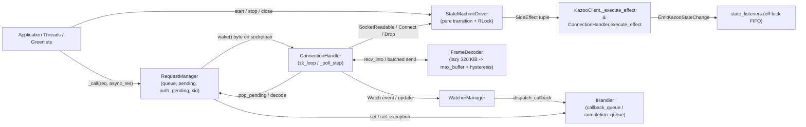
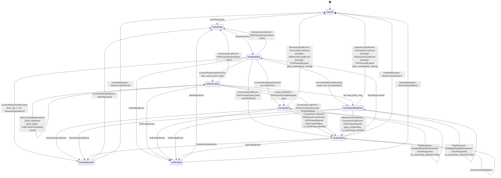
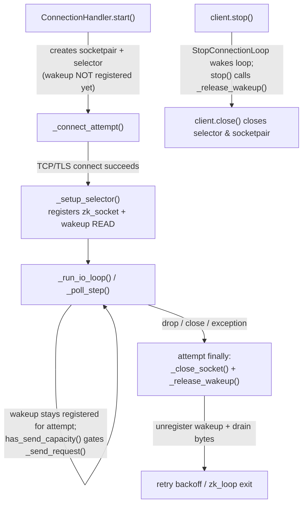
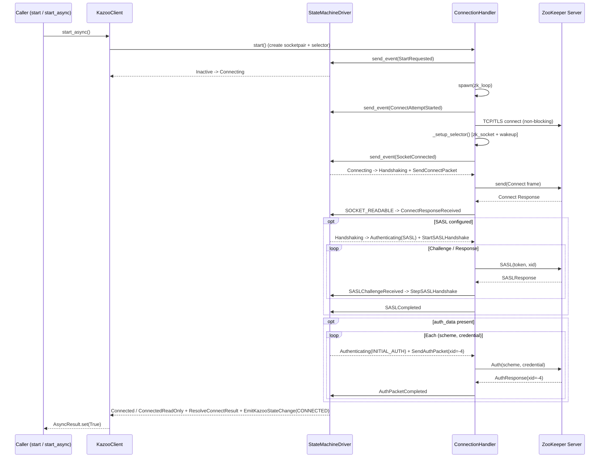

# Kazoo Core Design Document

This document explains the internal architecture and runtime mechanics of Kazoo's core session, transport, state machine, wire codec, event loop, and handler subsystems.

> [!NOTE]
> For the complete state/event/effect catalog and formal transition matrix rules, see [STATES.md](STATES.md).

---

## 1. Architecture Overview & Evolution Since `next`

Kazoo separates **session/lifecycle policy** from **socket I/O** and **concurrency primitives** around five cooperating components:

1. **Client Facade (`KazooClient`)**: Public ZooKeeper API, recipe factories, retry orchestration, request submission, watcher tables, and state listener dispatch ([kazoo/client.py](kazoo/client.py)).
2. **Pure Sans-I/O State Machine (`statemachine`)**: Immutable dataclass states, typed events, pure `transition(state, event)` table, and serialized `StateMachineDriver` ([kazoo/protocol/statemachine.py](kazoo/protocol/statemachine.py)).
3. **Connection & Event Loop (`ConnectionHandler`)**: Persistent selector loop, wakeup socketpair, non-blocking socket read/write engine, SASL stepper, and direct data-plane fast path ([kazoo/protocol/connection.py](kazoo/protocol/connection.py), [kazoo/protocol/session.py](kazoo/protocol/session.py), [kazoo/protocol/sasl.py](kazoo/protocol/sasl.py), [kazoo/protocol/tls.py](kazoo/protocol/tls.py)).
4. **Wire Framing & Serialization (`FrameDecoder`, packet & security dataclasses)**: Lazily allocated, on-demand-growing linear-buffer `recv_into` framing with unified `xid` dispatch and in-decoder `ResponsePacket` deserialization ([kazoo/protocol/serialization.py](kazoo/protocol/serialization.py), [kazoo/protocol/paths.py](kazoo/protocol/paths.py), [kazoo/security.py](kazoo/security.py)).
5. **Handler Abstraction (`IHandler`)**: Pluggable OS-thread or greenlet runtime providing sockets, selectors, locks, `IAsyncResult`, cooperative yields, and sequential callback workers ([kazoo/interfaces.py](kazoo/interfaces.py), `kazoo/handlers/`).



### Summary of Structural Changes Since `next`

Current architecture highlights (Python `>=3.10` required):

| Area | Legacy (`next`) Model | Current Architecture | Source |
| :--- | :--- | :--- | :--- |
| **Lifecycle & State** | Mutable booleans/flags distributed across `KazooClient` and `ConnectionHandler` (`_state`, `_live`, ad-hoc locks) | Immutable frozen slotted `ClientState` union driven by pure `transition()` returning `tuple[SideEffect, ...]` and RLock-serialized `StateMachineDriver` | [statemachine.py](kazoo/protocol/statemachine.py) |
| **Socket Multiplexing** | Per-poll `handler.select([sock, read_sock], ...)` calls rebuilding fd sets every iteration | Persistent `handler.create_selector()` (`selectors.BaseSelector`) with per-attempt `"wakeup"` registration (`_setup_selector` / `_release_wakeup`) | [connection.py](kazoo/protocol/connection.py) |
| **Packet Framing & Reads** | Per-frame `recv(4)` + loop of `recv(remaining)` allocating per-packet `bytes`/`BytesIO` | Lazily allocated, on-demand-growing linear `FrameDecoder` (initial `min(_capacity, READ_WINDOW + MOVE_MAX)` = 320 KiB, growing up to `READ_WINDOW + 4 + max_buffer + REPLY_OVERHEAD` for large replies and shrinking back after bursts/reset, released on `close()`), non-blocking `recv_into`, unified `xid` dispatch (`_decode_packet`), in-decoder `ResponsePacket` decoding, and burst-drain `frame_ready` loop | [serialization.py](kazoo/protocol/serialization.py) |
| **Writes** | Per-request send buffered through selector wait | Coalesced outbound batching (up to `64 KiB` via `encode_request_into`), optimistic non-blocking `socket.send(memoryview)` / SSL `.write()`, and persistent `self._selector` slow-path waiting via `_socket_io_wait()` under `deadline` | [connection.py](kazoo/protocol/connection.py) |
| **Wire Packets, Security, TLS & SASL** | Mutable classic Python classes and inline dict/puresasl/ssl branching inside connection & handler code | `@_packet` (`@dataclass_transform(frozen_default=True)` + `@dataclass(slots=True)`) wire packets + frozen slotted `ACL`/`Id` (`Permissions` `IntFlag`), extracted `TLSConfig`/`build_ssl_context()`, and `SASLConfig`/`SASLExchange` | [serialization.py](kazoo/protocol/serialization.py), [security.py](kazoo/security.py), [tls.py](kazoo/protocol/tls.py), [sasl.py](kazoo/protocol/sasl.py) |
| **Session & Routing Containers** | Loose `_queue`, `_pending`, 4 watcher dicts, and inline packet/RO logic inside connection | Transport-agnostic `RequestManager`, `WatcherManager`, `PacketRouter`, `RWProbeSchedule`, and `_exception_to_event` in `protocol/session.py` (re-exported by `connection.py`, with client property aliases preserved) | [session.py](kazoo/protocol/session.py), [connection.py](kazoo/protocol/connection.py), [client.py](kazoo/client.py) |

---

## 2. Client Layer (`KazooClient`)

`KazooClient` ([kazoo/client.py](kazoo/client.py)) wires together the handler, state machine, managers, retry policies, and connection handler during initialization:

* **`self.handler`**: Defaults to `SequentialThreadingHandler()` if not supplied.
* **`self._state_machine`**: `StateMachineDriver(self._execute_effect, lock=self.handler.rlock_object(), post_dispatch=self._drain_state_changes)` initialized in `Inactive()` (lock-agnostic driver with zero `IHandler` import; user state listeners drain in FIFO order after releasing `_dispatch_lock`).
* **Derived state properties** ([kazoo/client.py](kazoo/client.py)): Neither `KazooState` nor `KeeperState` is stored separately; `client.state_machine` returns `self._state_machine.state`, `client.state` returns `state.kazoo_state`, and `client.client_state` returns `state.keeper_state`.
* **`self._request_manager` & `self._watcher_manager`**: Owned by the client and shared with `ConnectionHandler` (`_requests`, `_watchers`). Backward-compatible property getters/setters on `KazooClient` (`_queue`, `_pending`, `_child_watchers`, `_data_watchers`, `_persistent_watchers`, `_persistent_recursive_watchers`) delegate to these managers.
* **`self.max_buffer`**: Configurable via `KazooClient(..., max_buffer=JUTE_MAX_BUFFER)` (must be `> 0`, else `ConfigurationError`), forwarded to `ConnectionHandler` to size the `FrameDecoder` maximum buffer for servers with custom `jute.maxbuffer` ([kazoo/client.py](kazoo/client.py)).
* **`self._conn_retry` & `self.retry`**: Validated to share `self.handler.sleep_func`. `ConnectionHandler` receives a `.copy()` of `_conn_retry` and binds its copy's `interrupt` to `lambda: self._is_terminal`.
* **`SASLConfig.from_client_options(sasl_options, self.auth_data)`**: Extracts typed `SASLConfig` from either `sasl_options` or legacy `("sasl", ...)` entries in `auth_data`, keeping non-SASL `(scheme, credential)` pairs in `self.auth_data`.

### Request Submission Path (`_call`)

Every asynchronous ZooKeeper operation flows through `KazooClient._call(request, async_object)` ([kazoo/client.py](kazoo/client.py)):

1. **Terminal/closing-state fast fail**: Checks `self._state_machine.state`:
   * `AuthFailed` -> sets `AuthFailedError()`, returns `False`.
   * `ExpiredSession` -> sets `SessionExpiredError()`, returns `False`.
   * `Inactive` or `not state.is_connecting_allowed` (e.g., `Connected` with graceful `Close` in flight) -> sets `ConnectionClosedError("Connection has been closed")`, returns `False`.
   * Note: `Suspended` / `Connecting` / `Handshaking` / `Authenticating` are *allowed* to enqueue requests; they sit in `_request_manager.queue` until the session establishes or fails.
2. **Enqueue, post-enqueue check & unconditional wake**: Calls `self._request_manager.enqueue(request, async_object)` and immediately re-checks `_terminal_call_exception(self._state_machine.state)` so a concurrent `stop()` / terminal transition cannot leave the entry orphaned in `queue` (removing and failing it if still queued). Otherwise unconditionally calls `self._connection.wake()` to avoid lost-wakeup races between producer threads and the selector loop.
3. **Closed wakeup recovery**: If `wake()` returns `False` (the wakeup pipe is closed/absent), the item is removed via `_request_manager.remove_queued(request, async_object)` and `async_object` fails with `ConnectionClosedError`.

### Session State Listeners & Effect Routing

`KazooClient._execute_effect(effect)` ([kazoo/client.py](kazoo/client.py)) splits `SideEffect` execution between client concerns and connection concerns:

* Client-handled effects:
  * `LogStateTransition` -> `self.logger.log(...)`
  * `ResolveConnectResult` -> resolves or fails `self._conn_result` if not already ready
  * `EmitKazooStateChange` -> queues notification via `self._make_state_change(new_state)` (drained off-lock in FIFO order by `StateMachineDriver`'s `post_dispatch` hook)
  * `FailPendingRequests` -> `self._request_manager.fail_all(keeper_state)`
  * `InvalidateWatchers` -> `self._reset_watchers()` (clears all watcher maps and schedules `WatchedEvent(EventType.NONE, self.client_state, None)` via `handler.dispatch_callback`)
  * `ResetSessionData` -> calls `self._reset()` (resets managers, watchers, `_session_id`, `_session_passwd`, `last_zxid = 0`, `_protocol_version = None`) and forwards to `self._connection.execute_effect(effect)` to reset `FrameDecoder` and retry state.
* Transport-handled effects (`ReadSocketPacket`, `DrainWakeupPipe`, `SendHeartbeatPing`, `StartSASLHandshake`, `StepSASLHandshake`, `SendAuthPacket`, `EnqueueCloseRequest`, `CloseSocket`, `SessionEstablished`, `StopConnectionLoop`, `SendConnectPacket`, `ReadConnectResponsePacket`, `UpdateSessionData`, `ConfigureTimeouts`, `ConfigureReadOnlyMode`) -> delegated to `ConnectionHandler.execute_effect()`.

> [!IMPORTANT]
> In [kazoo/client.py](kazoo/client.py), `EmitKazooStateChange` deduplicates against `self._last_notified_state` and enqueues notifications onto `_pending_state_changes`; `StateMachineDriver`'s `post_dispatch` hook then drains them via `_drain_state_changes()` **after releasing `_dispatch_lock`** (in strict FIFO order via a single-drainer loop) on the thread/greenlet that triggered the transition (for example `zk_loop` or a `stop()` caller), removing any listener that returns `True`. Listeners must never perform blocking ZooKeeper calls directly on that thread.

---

## 3. Sans-I/O Dataclass State Machine (`kazoo.protocol.statemachine`)

All session lifecycle rules live in [kazoo/protocol/statemachine.py](kazoo/protocol/statemachine.py) with **zero socket or handler I/O** inside `transition(state, event)`.



### States, Events, and Effects

* **9 Frozen Slotted `ClientState` Dataclasses**:
  `Inactive`, `Connecting`, `Handshaking`, `Authenticating` (carrying `stage: AuthStage`, `pending_auth`), `Connected`, `ConnectedReadOnly`, `Suspended`, `ExpiredSession`, `AuthFailed`.
  Each exposes uniform boolean/enum attributes used by the I/O loop: `keeper_state`, `kazoo_state`, `is_terminal`, `is_connected`, `is_connecting_allowed`.
* **18 `ClientEvent` Dataclasses**:
  Lifecycle (`StartRequested`, `ConnectAttemptStarted`, `SocketConnected`, `CloseRequested`, `SessionClosedEvent`), handshake/auth (`ConnectResponseReceived`, `SASLChallengeReceived`, `SASLCompleted`, `AuthPacketCompleted`), health/fault (`ConnectionLostEvent`, `SessionExpiredEvent`, `AuthFailedEvent`, `RWServerFoundEvent`), and hot-path poll events (`SocketReadable`, `WakeUpSignaled`, `PollTimeoutExpired`, `HeartbeatDeadlineReached`, `PingReceived`).
* **Immutable Effects & Hot-Path Allocation Avoidance**: `transition()` returns an immutable `tuple[SideEffect, ...]`. `SOCKET_READABLE`, `WAKEUP_SIGNALED`, `POLL_TIMEOUT_EXPIRED`, `HEARTBEAT_DEADLINE_REACHED`, and `PING_RECEIVED` — plus singleton effect tuples (`_EFFECTS_READ_SOCKET`, `_NO_EFFECTS`, etc.) — are pre-allocated at module import time so steady-state polls do not allocate on the heap ([statemachine.py](kazoo/protocol/statemachine.py)).

### `StateMachineDriver` Serialization & Re-entrancy

`StateMachineDriver.send_event(event)` ([kazoo/protocol/statemachine.py](kazoo/protocol/statemachine.py)) guarantees linear, in-order state transitions across application threads, connection routines, and re-entrant side effects:

1. **RLock-serialized dispatch**: Holds `_dispatch_lock` (`handler.rlock_object()`) across the outermost transition and effect execution. Cross-thread callers wait synchronously for the active transition to finish rather than returning early or having their events discarded if an effect fails, while same-thread re-entrant calls re-acquire the RLock, append to `_event_queue`, and return immediately.
2. **State before effects**: The outermost caller sets `_processing_events = True`, computes `next_state, effects = transition(self.state, current_event)`, assigns `self.state = next_state` **before** executing `effects` (so effects and external observers reading `client.state` see the post-transition state), and then executes each effect sequentially.
3. **Drain & failure cleanup**: Pops any queued same-thread re-entrant events in FIFO order. If any effect raises, the `finally` block clears `_event_queue` and resets `_processing_events = False`; `ConnectionHandler` then catches the exception and tears down the socket/attempt.

---

## 4. Connection Handler, Managers & Event Loop (`kazoo.protocol.connection`)

### `RequestManager` & `WatcherManager` (`kazoo.protocol.session`)

* **`RequestManager`** ([kazoo/protocol/session.py](kazoo/protocol/session.py)):
  * **`queue`**: `deque[(request, async_object)]` populated by caller threads in `KazooClient._call()`.
  * **`pending` & `auth_pending`**: `pending` is `deque[(request, async_object, xid)]` populated on the I/O routine as positive-XID requests (including SASL steps) are serialized and written to the socket (`dequeue_to_pending(xid)`). **`Auth` requests use `ReservedXID.AUTH = -4`** and are tracked separately in `auth_pending: deque[ICompletion | None]` (`pop_auth_pending()`) so out-of-band auth replies cannot desynchronize positive-XID FIFO `pending`.
  * **XID discipline**: Reset to `0` at the start of every `_connect_attempt()`. Normal operations and SASL steps receive strictly increasing 31-bit XIDs via `next_xid()` (`1..2147483647`) and ZooKeeper answers them FIFO (`pop_pending()`).
  * **Rate limit**: `has_send_capacity(concurrent_request_limit)` bounds `len(pending) + len(auth_pending)`. During terminal shutdown (`_is_terminal`), `_send_request()` drains remaining queued requests (such as `Close`) even if the pipeline is saturated ([connection.py](kazoo/protocol/connection.py)).
  * **`fail_in_flight(exc)` & `fail_all(keeper_state)`**: `fail_in_flight()` drains `pending` and `auth_pending` on socket teardown (clearing orphaned SASL/in-flight entries while preserving `queue`); `fail_all()` also drains `queue`, failing non-`None` completion handles with `AuthFailedError`, `SessionExpiredError`, or `ConnectionLoss`.
* **`WatcherManager`** ([kazoo/protocol/session.py](kazoo/protocol/session.py)):
  * Maintains four `defaultdict(set)` tables: `data_watchers`, `child_watchers`, `persistent_watchers`, and `persistent_recursive_watchers`.
  * `update_for_response(request)` registers watchers only after a successful server reply (or removes them on `RemoveWatches`).
  * `collect_for_event(watch_type, path)` pops one-shot `data_watchers` / `child_watchers` while retaining `persistent_watchers` and O(d) ancestor-matched `persistent_recursive_watchers` (short-circuiting immediately when `persistent_recursive_watchers` is empty).

### Selector & Wakeup Socketpair Lifecycle

A persistent selector (`self._selector = self.handler.create_selector()`) and non-blocking wakeup socketpair (`_read_sock`, `_write_sock`) are created in `ConnectionHandler.start()` ([kazoo/protocol/connection.py](kazoo/protocol/connection.py)) and closed in `ConnectionHandler.close()`.



Why `"wakeup"` is registered per attempt and released via `_release_wakeup()`:
* Keeping `"wakeup"` registered throughout an active connection attempt ensures `client.stop()` can always interrupt an in-flight `select()` (including on Gevent/Eventlet selectors where cross-greenlet `modify()` does not wake a parked `select()`). Backpressure is enforced by `RequestManager.has_send_capacity()` inside `_send_request()` rather than toggling selector registration.
* Because `_call()` writes `b"\0"` to `_write_sock` unconditionally (even between reconnect attempts or right as `zk_loop` finishes), leaving `_read_sock` registered on `self._selector` outside an attempt would cause hub-backed selectors (notably gevent's persistent selector) to see an already-readable fd and busy-spin.
* `_release_wakeup()` unregisters `"wakeup"` (`_update_io_interest(0, "wakeup")`) and drains all pending bytes (`recv(4096)` until empty/`BlockingIOError`) at the end of every `_connect_attempt()` (`finally:`), at `zk_loop()` exit (`finally:`), and at the end of `stop()` (once the connection routine has exited) ([connection.py](kazoo/protocol/connection.py)).

### Reconnect & Connection Attempt Pipeline

1. **`zk_loop()`** ([connection.py](kazoo/protocol/connection.py)) wraps `_connect_loop` in `self.retry_sleeper.copy()` until `_is_terminal` becomes `True` or `RetryFailedError` exhausts retries. In `finally:`, it emits `SessionClosedEvent` if not already `Inactive`/`AuthFailed`, calls `_release_wakeup()`, and **then** sets `connection_stopped` so `stop()` returns only after teardown completes.
2. **`_connect_loop()`** ([connection.py](kazoo/protocol/connection.py)) resolves all client hosts via `socket.getaddrinfo`, shuffles if `randomize_hosts` is enabled, and tries `_connect_attempt(host, hostip, port, retry)` for each address.
3. **`_connect_attempt()`** ([connection.py](kazoo/protocol/connection.py)):
   * Honors `self._rw_server` if `RWPinger` discovered a read/write server.
   * Emits `ConnectAttemptStarted`, resets `xid = 0` and `_frame_decoder.reset()`.
   * Creates TCP (optionally SSL-wrapped, reusing a cached `ssl.SSLContext` built from `TLSConfig`) socket via `handler.create_connection()`, sets non-blocking (`setblocking(False)`), caches `_ssl_socket` when SSL is active, registers `"zk_socket"` and `"wakeup"` via `_setup_selector()`.
   * Emits `SocketConnected(...)`, which triggers `SendConnectPacket` (sending the `Connect` handshake frame immediately and arming a monotonic `_phase_deadline`).
   * Enters `_run_io_loop()` (running only while in `(Handshaking, Authenticating, Connected, ConnectedReadOnly)` with an open socket), catching transport/protocol exceptions and translating them through `_exception_to_event()` ([session.py](kazoo/protocol/session.py)):
     * `timeout_exception`, `OSError`, `ConnectionDropped` -> `ConnectionLostEvent` (keep retry backoff).
     * `AuthFailedError`, `SASLException`, `SessionClosedRequireSaslError` -> `AuthFailedEvent` (reset retry, `STOP_CONNECTING`).
     * `SessionExpiredError` -> `SessionExpiredEvent` (reset retry, reconnect with new session).
     * `RWServerAvailable` -> `RWServerFoundEvent` (reset retry, reconnect to `self._rw_server`).

### Steady-State Event Loop (`_poll_step`) & Direct Data-Plane Fast Path

During handshake/SASL/initial-auth (`not _is_session_active`), `_poll_step()` delegates socket reads and wakeups as events (`SOCKET_READABLE`, `WAKEUP_SIGNALED`) to the state machine and enforces a monotonic `_phase_deadline` so stray wakeups or partial reads cannot extend phase timeouts indefinitely.

Once connected (`Connected` or `ConnectedReadOnly`), `_poll_step()` ([connection.py](kazoo/protocol/connection.py)) uses a **direct data-plane fast path** that avoids state-machine lock acquisitions and transition overhead on every request/reply:

1. **Optimistic queued send**:
   * If `_requests.queue` is non-empty and either `_is_terminal` or `has_send_capacity(limit)`, drains the wakeup pipe when signaled (`_drain_wakeup()`) and flushes queued requests via `_send_request()` directly before blocking in `_select()`. `_send_request()` reuses a persistent `self._send_buf` (trimmed if a flush exceeds `_SEND_BATCH_MAX`) and coalesces queued frames up to `_SEND_BATCH_MAX = 64 KiB` using `FrameDecoder.encode_request_into()` and zero-copy `_serialize_into()` methods.
2. **Burst-drain vs. selector wait**:
   * If `self._frame_decoder.frame_ready` is already `True` (multiple frames arrived in a single `recv_into()`), `_poll_step()` **skips both `_compute_poll_timeout()` and `_select()`** and reads the next cached packet directly.
   * To prevent starving sibling greenlets (or threads) during massive reply bursts, every `_REPLIES_PER_YIELD = 64` consecutive bypassed iterations, `_poll_step()` resets the counter, calls `self._yield_control()` (`gevent.sleep(0)` / `eventlet.sleep(0)` / no-op on threading), and runs `_check_session_health()`.
   * Otherwise resets `_replies_since_select = 0`, computes `timeout` via `_compute_poll_timeout(state)` (using a cached `_heartbeat_deadline` with jitter capped at `read_timeout / 4` so short session timeouts `<= 1.2s` never collapse to `0.0`, keyed on scalar `_heartbeat_ref_time`/`_heartbeat_read_timeout`), and waits in `_select(timeout)`. Note that `_select()` ([connection.py](kazoo/protocol/connection.py)) checks `ssl_sock.pending() > 0` first; if TLS already buffered decrypted plaintext in OpenSSL, it calls `selector.select(0.0)` and includes `"zk_socket"` in `ready`.
3. **Priority dispatch in `_dispatch_ready_events(ready)`** ([connection.py](kazoo/protocol/connection.py)):
   * Empty `ready` -> `_emit_event(POLL_TIMEOUT_EXPIRED)` (drops if `ping_outstanding` in `Connected*`, or drops if handshake/SASL timed out).
   * `"zk_socket"` -> `_read_socket()` directly if `_is_session_active`, else `_emit_event(SOCKET_READABLE)`. Returns early if the packet caused disconnection/terminal state.
   * `"wakeup"` -> if `_is_session_active`, drains wakeup, flushes outbound queue via `_send_request()`, runs `_check_session_health()` (so continuous outbound wakeups cannot starve heartbeats or dead-peer timeout detection), and returns; if non-active, emits `WAKEUP_SIGNALED` and falls through so `_phase_deadline` is still enforced.
   * `_check_session_health()` recomputes the cached heartbeat deadline after I/O, raises `timeout_exception` if a peer with outstanding traffic (`ping_outstanding`, `pending`, or `auth_pending`) has been silent for `>= _read_timeout`, and otherwise emits `HEARTBEAT_DEADLINE_REACHED` -> `_send_ping()` (which writes the pre-encoded `_PING_FRAME`) once `monotonic() >= deadline`. While `ping_outstanding` is `True`, `_compute_poll_timeout()` bounds the wait by `min(_last_send + _read_timeout / 2 - jitter, _last_recv + _read_timeout)`.

### Non-Blocking Outbound Engine (`_write`)

`_write(msg, timeout)` ([connection.py](kazoo/protocol/connection.py)) eliminates unnecessary write-selector syscalls when kernel socket buffers have room:

1. **Optimistic path**: Wraps `msg` (`bytes | bytearray`) in a `with memoryview(msg) as view:` context manager (releasing all buffer exports deterministically for PyPy) and calls `write_fn(view)` immediately — using `.write()` on SSL sockets (so non-blocking `gevent.ssl.SSLSocket` re-raises `SSLWantReadError`/`SSLWantWriteError` instead of returning `0`) and `.send()` on plain sockets. If all bytes are accepted, returns with zero `select()` calls.
2. **Slow path**: On partial write, `BlockingIOError`, or `SSL_ERROR_WANT_READ`/`SSL_ERROR_WANT_WRITE`, computes `deadline = monotonic() + eff_timeout`, strictly enforces `deadline - monotonic() > 0`, and reuses the single persistent `self._selector` via `_socket_io_wait()` (temporarily unregistering `"wakeup"` without draining unread wake bytes, switching `zk_socket` between `EVENT_WRITE` and `EVENT_READ` via `modify()` only on direction changes, and restoring `zk_socket` `EVENT_READ` + `"wakeup"` in `finally:`), writing `with view[sent:] as chunk:` slices without copying `msg` until complete or `timeout_exception` fires.
3. A `0`-byte send raises `ConnectionDropped("socket connection broken")`.
4. **Loop-routine confinement**: `CloseSocket` and `ResetSessionData` mutate sockets, selectors, and `FrameDecoder` only when running on `zk_loop`'s routine (tracked via `_ACTIVE_CONNECTION_LOOP` pairing `(self, threading.get_ident())` so both greenlets and threads with inherited contexts are distinguished) or after `connection_stopped` is set; off-routine callers (such as `client.stop()`) only call `wake()` so `_connect_attempt()`'s `finally:` block performs teardown safely on its own routine.

### SASL & Initial Auth Handshake (`Authenticating`)

When a server replies to `Connect` ([kazoo/protocol/sasl.py](kazoo/protocol/sasl.py), [connection.py](kazoo/protocol/connection.py)):

* If `sasl_config` is configured, `Authenticating(stage=AuthStage.SASL)` emits `StartSASLHandshake(host)`:
  * `SASLConfig.effective_host(host)` returns `"zk-sasl-md5"` for `DIGEST-MD5` or the connected `host` otherwise (e.g., `GSSAPI`, `PLAIN`, or custom mechanisms).
  * `SASLExchange` wraps `puresasl.client.SASLClient`, normalizing `SASLProtocolException` -> `AuthFailedError` and `SASLError` / unexpected errors -> `SASLException` in both `__init__()` and `next_token()`.
  * `_step_sasl()` appends `(SASL(token), None, xid)` to `_requests.pending` before writing `SASL(token)` with monotonically assigned `xid`; `FrameDecoder` decodes matching replies into `SASLResponse`, which feeds challenges into `SASLChallengeReceived` -> `StepSASLHandshake` until `next_token` returns `None` / `is_complete` -> `SASLCompleted()`. Transient SASL server error codes raise `ConnectionDropped` (retryable); permanent auth errors trigger `AuthFailedEvent`.
* Next (or immediately if no SASL), if non-SASL `auth_data` tuples remain, `Authenticating(stage=AuthStage.INITIAL_AUTH)` iterates `SendAuthPacket(scheme, credential)` (`xid = ReservedXID.AUTH = -4`) and advances on `AuthPacketCompleted()` until all credentials succeed, then `_finalize_connected()` transitions to `Connected` or `ConnectedReadOnly`.

---

## 5. Wire Framing, Serialization & Memory Model (`kazoo.protocol.serialization`)

### ZooKeeper Wire Format & Typed Packets

Every client-to-server request (after the initial un-XID'd, op-less `Connect` frame) is framed by `FrameDecoder.encode_request_into(buf, request, xid)` / `FrameDecoder.encode_request(request, xid)` ([serialization.py](kazoo/protocol/serialization.py)):

```text
Normal Request:  [4B big-endian len] [4B xid] [4B op_type] [serialized payload]
Connect Request: [4B big-endian len] [proto_ver, last_zxid, timeout, session_id, passwd, read_only]
Server Reply:    [4B big-endian len] [4B xid | 8B zxid | 4B err] [response / watch / SASL payload]
Connect Reply:   [4B big-endian len] [proto_ver, timeout, session_id, passwd, (optional 1B read_only)]
```

* **Pre-compiled structs**: `bool_struct` (`B`), `int_struct` (`!i`), `int_int_struct` (`!ii`), `int_int_long_struct` (`!iiq`), `int_long_int_long_struct` (`!iqiq`), `long_struct` (`!q`), `multiheader_struct` (`!iBi`), `reply_header_struct` (`!iqi`), `watch_header_struct` (`!iqiii`), `stat_struct` (`!qqqqiiiqiiq`).
* **Dataclass wire types (`@_packet`)**: Every request/response (`Connect`, `Ping`, `Create`, `Create2`, `CreateContainer`, `CreateTTL`, `GetData`, `SetData`, `GetChildren`, `GetChildren2`, `Exists`, `Delete`, `GetACL`, `SetACL`, `AddWatch`, `RemoveWatches`, `Sync`, `Auth`, `SASL`, `Close`, `Transaction`, `Reconfig`, `ReplyHeader`, `MultiHeader`) and decoded server packet (`PingResponse`, `AuthResponse`, `WatchPacket`, `SASLResponse`, `ResponsePacket`) uses `@_packet` ([serialization.py](kazoo/protocol/serialization.py)), which applies `@dataclass_transform(frozen_default=True)` over `@dataclass(slots=True)`. Type checkers (`mypy`) still reject mutation statically, while runtime packet construction avoids frozen `__setattr__` dispatch overhead (instances are not frozen or hashable at runtime).
* **Inline multi-header transaction decoding**: `Transaction.deserialize` ([serialization.py](kazoo/protocol/serialization.py)) unpacks `multiheader_struct` directly into locals without allocating temporary `MultiHeader` objects per operation result.
* **Single-copy string decoding**: `_read_required_string(buffer, offset)` ([serialization.py](kazoo/protocol/serialization.py)) decodes UTF-8 directly via `str(buffer[index : index + length], "utf-8")` on `bytes | memoryview`, avoiding an extra `.tobytes()` intermediate copy.
* **Security dataclasses** ([kazoo/security.py](kazoo/security.py)): `Permissions` is `enum.IntFlag` (`NONE..ALL=31`); `Id` and `ACL` are frozen slotted dataclasses with deprecated sequence compatibility (`__iter__`, `__getitem__`, `__len__`) and `__bool__` returning `True`.

### `FrameDecoder`: Growing Linear Buffer, Bounds & In-Decoder Dispatch

`FrameDecoder` ([kazoo/protocol/serialization.py](kazoo/protocol/serialization.py)) decouples OS socket reads from frame boundaries with a lazily allocated, on-demand-growing linear buffer and synchronous in-decoder response parsing:

* **Buffer Sizing Constants**:
  * `JUTE_MAX_BUFFER = 0xFFFFF` (`1,048,575` bytes — ZooKeeper default `jute.maxbuffer`, configurable via `KazooClient(..., max_buffer=...)`)
  * `REPLY_OVERHEAD = 88` (`16`B `ReplyHeader` + `4`B data length + `68`B `ZnodeStat`), giving default `_max_payload = max_buffer + REPLY_OVERHEAD = 1,048,663` bytes and `_max_frame = 4 + _max_payload = 1,048,667` bytes
  * `READ_WINDOW = 256 * 1024` (`262,144` bytes — maximum start offset `_head` / `_scan` allowed for an incomplete frame before reads)
  * `MOVE_MAX = 64 * 1024` (`65,536` bytes — maximum trailing partial-frame size and remaining window threshold that triggers compaction to offset `0`, and size threshold for shrink hysteresis)
  * `_SHRINK_HYSTERESIS = 32` — number of consecutive small (`<= MOVE_MAX`) frames draining `_head == _tail` required before shrinking a grown buffer back to `_initial_capacity`, preventing allocation thrashing on mixed large/small workloads (e.g., large reads interleaved with heartbeat pings)
  * Maximum capacity `_capacity = READ_WINDOW + 4 + max_buffer + REPLY_OVERHEAD` (default `1,310,811` bytes), with initial capacity `_initial_capacity = min(_capacity, READ_WINDOW + MOVE_MAX)` = **`327,680` bytes** (`320 KiB` `bytearray` allocated **lazily** on the first `get_buffer()` call + persistent `_view = memoryview(_buf)` and cached `_empty_view = _view[:READ_WINDOW]`). When a frame exceeds the current buffer length, `_grow_buffer()` compacts live bytes `[head:tail]` directly to offset `0` of a newly sized buffer (doubling up to `_capacity`) without an intermediate copy. `reset()` shrinks back to `_initial_capacity`; `release()` (called in `ConnectionHandler.close()`) drops `_buf`/`_view`/`_empty_view` directly without reallocating `_initial_capacity`.

```text
Growing Linear Buffer (_buf, len(_buf) in [_initial_capacity .. _capacity])
0                    _head       _scan        READ_WINDOW   _tail          len(_buf) <= _capacity
+--------------------+-----------+------------+-------------+--------------+
| consumed [0.._head)| complete  | incomplete | writable [tail..end)       |
+--------------------+-----------+------------+----------------------------+
                      ^ frame starts < READ_WINDOW => grows on demand up to _capacity (compact-on-grow)
```

* **Frame-Start Rule (`< READ_WINDOW`) & Cursor Discipline**:
  * Cursors track `_head` (start of unpopped frame), `_scan` (where frame header validation stops), `_tail` (write cursor), `_frame_len` (cached payload length at `_head`, or `-1`), `_skip` (remaining bytes of an oversize frame to discard), and `_small_frames_since_grow` (hysteresis counter when `len(_buf) > _initial_capacity`).
  * `buffer_updated()` calls `_advance_scan()`, which walks complete frames `[4 + msg_len]` forward from `_scan`, rejecting `msg_len < 16` or oversize non-request frames (`xid <= 0`) at `_head` with `ConnectionDropped` (while deferring corrupt headers that follow valid coalesced replies so earlier replies are delivered first).
  * Before requesting a write slice in `get_buffer()`, `_scan` must be strictly less than `READ_WINDOW` (if complete frames push `_scan >= READ_WINDOW`, `get_buffer()` raises `BufferError` so callers pop buffered frames first). Because any incomplete frame starts at `_scan < READ_WINDOW` and `_capacity = READ_WINDOW + _max_frame`, every frame within `max_buffer + REPLY_OVERHEAD` fits contiguously once `_buf` grows to accommodate it.
* **Compaction / Move & Shrink Rule**:
  * **Empty fast path**: When `_head == _tail` (all frames consumed), `get_buffer()` resets `_head = _tail = _scan = 0` and returns the pre-sliced `_empty_view` (`_view[:READ_WINDOW]`), avoiding `memoryview` slice allocation on every empty read.
  * **Lazy partial compaction & on-demand growth**: For non-empty buffers, `get_buffer()` targets `end = max(_scan + need, READ_WINDOW)` (where `need` is `4`, `20` for an oversize header, or `4 + msg_len`). If `end > len(_buf)`, `get_buffer()` checks whether shifting live bytes `[_head:_tail]` to offset `0` fits (`shifted_end = max(READ_WINDOW, end - _head) <= len(_buf)`); if so, it compacts in place, otherwise it calls `_grow_buffer(shifted_end)` (which compacts live bytes to offset `0` into the new grown buffer). Otherwise, when `end - _tail < MOVE_MAX` and the buffered remainder `p = _tail - _head <= MOVE_MAX`, `get_buffer()` copies `_view[_head:_tail]` down to `_view[:p]` and resets `_head = 0`.
  * **Shrink hysteresis**: When `len(_buf) > _initial_capacity`, `pop_packet()` resets `_small_frames_since_grow = 0` on frames with `n > MOVE_MAX`, increments it on small (`n <= MOVE_MAX`) frames, and shrinks back to `_initial_capacity` once `_head == _tail` and `_small_frames_since_grow >= _SHRINK_HYSTERESIS`.
* **Size Limit (`max_buffer + 88`) & Oversize Frame Skipping**:
  * Replies with `msg_len < 16` raise `ConnectionDropped`.
  * Replies with `msg_len > max_buffer + REPLY_OVERHEAD`:
    * Reserved/unsolicited frames (`xid <= 0`) raise `ConnectionDropped` once at `_head`.
    * Request replies (`xid > 0`) become ready as soon as `20` bytes (`[4B len][16B ReplyHeader]`) are buffered. `pop_packet()` pops FIFO pending via `_pop_pending()`, verifies `header.xid == expected_xid` (raising `ConnectionDropped` on `SASL` or missing/empty pending, `RuntimeError` on mismatch), stores `_skip = max(0, end - _tail)` (keeping any bytes past `end` aligned if already buffered), and returns `ResponsePacket(..., error=ReplyTooLargeError(...))`.
    * While `_skip > 0`, `get_buffer()` returns `_empty_view` and `buffer_updated()` discards `min(_skip, nbytes)` bytes in place, retaining any trailing next-frame bytes without losing stream alignment.
* **Non-Blocking Pull/Push Cycle in `ConnectionHandler._read_packet()`** ([connection.py](kazoo/protocol/connection.py)):
  1. Calls `decoder.pop_packet()`. If a frame (or actionable 20-byte oversize header) is already buffered, returns immediately without touching the socket.
  2. Otherwise calls `buf = decoder.get_buffer()` and `sock.recv_into(buf)` (never calling `buf.release()` because `get_buffer()` may return cached `_empty_view`).
  3. `nbytes == 0` -> resets decoder and raises `ConnectionDropped("socket connection broken")`.
  4. `nbytes > 0` -> records `_last_recv = time.monotonic()`, calls `decoder.buffer_updated(nbytes)`, and re-checks `pop_packet()`. If the reply is still incomplete (a short read), loops straight back to step 2 without blocking while bytes are available.
  5. When the socket would block (`BlockingIOError` or `SSL_ERROR_WANT_READ`), `_read_packet()` returns `None` immediately (looping only if SSL `pending() > 0`) so control returns to the main `_poll_step()` selector — ensuring `client.stop()`, wakeups, and deadlines are never blocked inside a partial frame read. On rare `SSL_ERROR_WANT_WRITE` during TLS renegotiation, `_read_packet()` waits for writability on the persistent `self._selector` via `_socket_io_wait()` bounded by a cumulative deadline (`write_deadline = now + eff`).
* **Unified `xid` Dispatch & In-Decoder Deserialization**:
  * `FrameDecoder(..., pop_pending=...)` removes `is_connect` / `is_sasl` state flags: ZooKeeper's `ConnectResponse` has `0` in its first `int` field (`protocolVersion`), so internal `_decode_packet()` ([serialization.py](kazoo/protocol/serialization.py)) unpacks `reply_header_struct` (`!iqi`) once at offset `0` and dispatches uniformly on `xid`:
    * `0` (`ReservedXID.CONNECT`) -> `Connect.deserialize(frame, 0)`
    * `-1` (`ReservedXID.WATCH`) -> unpacks `(watch_type, state)` at offset `16` + `_read_required_string` into `WatchPacket`
    * `-2` (`ReservedXID.PING`) -> `PingResponse(zxid=zxid, err=err)`
    * `-4` (`ReservedXID.AUTH`) -> `AuthResponse(zxid=zxid, err=err)`
    * Other `xid <= 0` -> `ConnectionDropped(f"Unknown reserved xid: {xid}")`
    * `xid > 0` -> pops `(request, async_object, expected_xid)` from `pop_pending()`, verifies matching `xid`, returns `SASLResponse` if `request.type == SASL.type`, skips body parsing if `err != 0`, or calls `request.deserialize(frame, 16)` synchronously into `ResponsePacket` (capturing deserialization exceptions into `ResponsePacket.error`).
  * **Exact end-of-frame check**: every `deserialize(buffer, offset)` returns `(value, end_offset)`, and `_decode_packet()` requires `end_offset == len(frame)`. Slicing clamps at the end of the frame, so an overstated last length field would otherwise decode silently; one comparison per frame covers every field, including each entry of `GetChildren` and `Transaction` replies. A mismatched request reply fails only that request with `MarshallingError` in `ResponsePacket.error` (the frame boundary is known, so the stream stays in sync). A mismatched or malformed connect, watch, or SASL frame raises `ConnectionDropped`, since there is no request to fail. Error replies (`err != 0`), ping, and auth frames carry no parsed body and are not checked. `Connect`'s optional trailing read-only byte is only consumed when present, so frames with and without it both match.
  * `pop_packet()` updates cursors *before* calling `_decode_packet(frame_view)` inside `try ... finally: frame_view.release()`, ensuring every frame view is released immediately with zero lent-`memoryview` lifetime state across calls.

### Packet Dispatch

`PacketRouter.process_packet(packet)` ([session.py](kazoo/protocol/session.py), delegated from `ConnectionHandler._process_packet()`) pattern-matches on the 6 `ServerPacket` variants (rejecting packets that are invalid for the current `ClientState` with `ConnectionDropped`):
* `Connect` -> `ConnectResponseReceived(connect_result=packet)`
* `PingResponse` -> `PING_RECEIVED` (clears `ping_outstanding`)
* `AuthResponse` -> updates `last_zxid`, pops from `RequestManager.auth_pending` (with fallback scan for `ReservedXID.AUTH`), resolves or fails the pending auth `AsyncResult`, raises `SessionExpiredError` / `ConnectionDropped` on transient errors, or emits `AuthFailedEvent` / `AuthPacketCompleted`
* `WatchPacket` -> collects and dispatches matching watchers via `WatcherManager` + `handler.dispatch_callback` (early-returning before `unchroot()`/`WatchedEvent` if no watchers match)
* `SASLResponse` -> updates `last_zxid`, classifies non-zero error codes (raising `AuthFailedError`/`SessionExpiredError`/`SessionClosedRequireSaslError` or `ConnectionDropped` for transient errors), else emits `SASLChallengeReceived`
* `ResponsePacket` -> `PacketRouter.read_response(packet)` ([session.py](kazoo/protocol/session.py)): updates `last_zxid`, fails `async_object` with `packet.error` if present (`ReplyTooLargeError` logs at debug and leaves the session alive; `KazooRetry` does not retry it), maps non-`Exists`/`NoNodeError` codes via `_error_for_code(header.err)`, unchroots `Transaction` results, registers/removes request watchers via `WatcherManager.update_for_response`, resolves `async_object`, and emits `SessionClosedEvent` on `Close`.

---

## 6. Concurrency Handlers (`kazoo.interfaces` & `kazoo.handlers`)

`IHandler` ([kazoo/interfaces.py](kazoo/interfaces.py)) abstracts execution primitives so `ConnectionHandler` and `StateMachineDriver` behave uniformly across OS threads, Gevent, and Eventlet:

| Primitive / Mechanism | `SequentialThreadingHandler` ([threading.py](kazoo/handlers/threading.py)) | `SequentialGeventHandler` ([gevent.py](kazoo/handlers/gevent.py)) | `SequentialEventletHandler` ([eventlet.py](kazoo/handlers/eventlet.py)) |
| :--- | :--- | :--- | :--- |
| **Selector (`create_selector()`)** | `selectors.DefaultSelector()` | `gevent.selectors.DefaultSelector()` | `_EventletSelector(selectors.BaseSelector)` (`green_selectors.DefaultSelector()`) |
| **Burst Yield (`yield_control()`)** | No-op (inherited default from `IHandler`) | `gevent.sleep(0)` every 64 cached frames | `eventlet.sleep(0)` every 64 cached frames |
| **Watch Queue (`callback_queue`)** | `queue.Queue` + daemon worker thread | `gevent.queue.Queue` + worker greenlet | `green_queue.LightQueue` + worker greenthread (with `_yield_before_after`) |
| **Completion Callbacks (`rawlink`)** | `completion_queue` (`queue.Queue`) + worker thread via `utils.AsyncResult` | Native `gevent.event.AsyncResult` hub dispatch | `completion_queue` (`LightQueue`) + worker greenthread via `utils.AsyncResult` |
| **State Listeners** | Queued in `_make_state_change()`, drained off-lock in FIFO order by `post_dispatch` on `send_event` thread | Queued in `_make_state_change()`, drained off-lock in FIFO order by `post_dispatch` on `send_event` greenlet | Queued in `_make_state_change()`, drained off-lock in FIFO order by `post_dispatch` on `send_event` greenthread |
| **Locks & Async Primitives** | `threading.Lock`, `RLock`, `Event`, `daemon Thread` | `gevent.lock.Semaphore`, `RLock`, `Event`, `Greenlet` | `green_threading.Lock`, `RLock`, `Event`, `eventlet.spawn` |

Because watch callbacks and `AsyncResult` completion callbacks execute on dedicated sequential workers (or hub callbacks on Gevent), blocking user code inside a watch handler stalls subsequent watches **but does not stall the `zk_loop` I/O routine, heartbeats, or `AsyncResult` completions**. Blocking inside a `state_listeners` function, however, runs synchronously on the `send_event()` caller (after `_dispatch_lock` is released) and stalls that thread/greenlet—and any subsequent queued state notifications—until it returns.

---

## 7. End-to-End Execution Flows

### A. Startup, Handshake, SASL & Authentication Sequence



### B. Steady-State Request/Reply & Reconnect Recovery

1. **Enqueue**: Application thread calls `zk.get_async("/p")` -> `_call()` -> `_request_manager.enqueue()` -> `wake()` writes `b"\0"` to wakeup socketpair.
2. **Wake & Send**: `_poll_step()` wakes from `self._selector.select()`, drains `_read_sock`, checks `has_send_capacity(limit)`, dequeues `(req, async_res)` to `pending` with monotonic `xid`, encodes `[len][xid][type][payload]`, and calls `_socket.send(memoryview)` optimistically.
3. **Receive & In-Decoder Decode**: Server replies -> `_select()` returns `"zk_socket"` -> `_read_packet()` reads into `_view` via `recv_into()` -> `pop_packet()` correlates `xid` via `pop_pending()`, deserializes directly from the frame `memoryview` slice into `ResponsePacket`, and immediately releases `frame_view` -> `_read_response()` updates watches via `WatcherManager` and calls `async_res.set(value)` (or fails with `ReplyTooLargeError` if the reply exceeded `max_buffer + REPLY_OVERHEAD`).
4. **Burst Drain**: If additional complete frames remain buffered, `FrameDecoder.frame_ready` bypasses `_select()` for up to 64 replies before calling `handler.yield_control()`.
5. **Drop & Recovery**: On socket drop or timeout, `_exception_to_event` emits `ConnectionLostEvent` -> `Suspended` -> fails `pending` + queued requests (`FailPendingRequests`), invalidates one-shot & persistent watches with `EventType.NONE` (`InvalidateWatchers`), emits `KazooState.SUSPENDED`, closes socket and runs `_release_wakeup()`, then `zk_loop` backs off via `KazooRetry` and attempts the next server host—preserving `session_id`/`_session_passwd` so ZooKeeper can resume the session (or reject it as expired -> `ExpiredSession` -> `ResetSessionData` -> `KazooState.LOST`).
