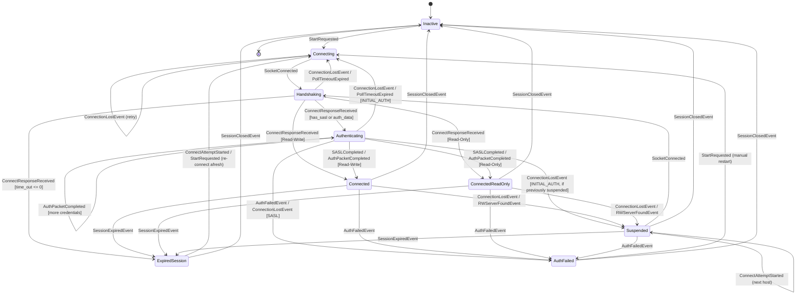

# Kazoo Client State Machine

This document defines the functional, immutable dataclass state machine powering the Kazoo ZooKeeper client ([`kazoo.protocol.statemachine`](kazoo/protocol/statemachine.py)).

---

## 1. State Machine Overview

The state machine implements a pure **Sans-I/O** architecture:
- **Zero I/O in transitions**: All transitions take `(ClientState, ClientEvent) -> tuple[ClientState, list[SideEffect]]`. The transition function is purely functional, deterministic, and free of side-effects.
- **Side Effect Commands**: I/O actions (socket transmission, packet parsing, selector interest updates, timer resets) are returned as immutable command objects executed by the driver.
- **Fail-Fast Exhaustiveness**: Any transition not explicitly declared as a valid transition or a benign no-op raises `InvalidStateTransitionError`.

---

## 2. State Taxonomy

All states inherit from the abstract base class `ClientState` and are frozen dataclasses. Each state defines `is_connecting_allowed: bool` (`False` for `Inactive` and `AuthFailed`, `True` for all other states).

| State | Category | Description |
| :--- | :--- | :--- |
| `Inactive` | Quiescent / Initial | Client is shut down, stopped, or has not yet called `start()`. |
| `Connecting` | Transitional | Client is resolving hosts, executing retry backoff, or establishing the transport TCP/TLS socket. |
| `Handshaking` | Transitional | Transport socket is established; the client has sent the initial `Connect` packet and is waiting for session negotiation. |
| `Authenticating` | Transitional | ZooKeeper session is negotiated; the client is performing `AuthStage.SASL` token exchange or `AuthStage.INITIAL_AUTH` credential exchange. |
| `Connected` | Active Session | Active, healthy read-write ZooKeeper session. User requests are actively dispatched. |
| `ConnectedReadOnly` | Active Session | Active read-only ZooKeeper session (read-only mode enabled). Background RW pinger searches for a read-write server. |
| `Suspended` | Active Session | Active session connection was dropped; client is actively reconnecting while retaining session credentials and watchers. |
| `ExpiredSession` | Terminal / Reconnect | The ZooKeeper ensemble expired the session. All ephemeral nodes and non-persistent watches are lost. |
| `AuthFailed` | Terminal | Authentication failed due to invalid credentials or SASL negotiation failure. Connection attempts permanently halt. |

---

## 3. Event Taxonomy

Events represent external occurrences from the network selector, user API calls, or timers.

### Lifecycle & Connection Events
- **`StartRequested()`**: Dispatched when `ConnectionHandler.start()` initiates a new connection cycle.
- **`ConnectAttemptStarted(host, port)`**: Dispatched when beginning a TCP/TLS connection attempt to a target endpoint.
- **`SocketConnected(...)`**: Transport socket successfully connected; contains negotiated endpoint parameters, session ID/password, and SSL options.
- **`ConnectResponseReceived(connect_result, zxid)`**: Initial ZooKeeper `Connect` response frame received from the server.
- **`ConnectionLostEvent(keeper_state, reason)`**: Transport socket dropped, disconnected, or timed out.
- **`CloseRequested()`**: Dispatched when `client.stop()` requests a graceful shutdown (forbidding reconnects if currently connected while allowing the `Close` packet to be sent, or transitioning immediately to `Inactive` if not connected).
- **`SessionClosedEvent()`**: Explicit close response received from ZooKeeper or client shutdown completed.
- **`SessionExpiredEvent(session_id)`**: Server reported session expiration.
- **`AuthFailedEvent(error)`**: Server reported authentication failure.
- **`RWServerFoundEvent(server)`**: Background read-only pinger discovered an available read-write server.

### Authentication Progression Events
- **`SASLChallengeReceived(challenge)`**: Server SASL challenge packet read from the socket.
- **`SASLCompleted()`**: SASL token exchange completed successfully.
- **`AuthPacketCompleted()`**: Initial auth packet reply received (`xid=AUTH_XID`).

### Selector & Event Loop Events
- **`SocketReadable()`**: Selector indicated ZooKeeper socket is ready for reading.
- **`WakeUpSignaled()`**: Selector indicated wakeup pipe has pending data (new user request enqueued).
- **`PollTimeoutExpired()`**: Selector timeout expired with no network activity.
- **`HeartbeatDeadlineReached()`**: Heartbeat ping deadline reached without sending traffic.
- **`PingReceived()`**: Heartbeat ping response (`xid=PING_XID`) read from the server.
- **`UpdateSendCapacity(can_send)`**: Evaluates concurrent request limits and updates wakeup interest.

---

## 4. Side Effect Taxonomy

Side effects are declarative command objects returned by `transition()` and dispatched by `execute_effect()`:

| Side Effect | Description |
| :--- | :--- |
| `SendConnectPacket` | Transmit initial ZooKeeper `Connect` frame. |
| `ReadConnectResponsePacket` | Read and deserialize initial length-prefixed `Connect` response. |
| `UpdateSessionData` | Update negotiated `session_id`, `session_passwd`, and `last_zxid`. |
| `ConfigureTimeouts` | Set negotiated `read_timeout` and `connect_timeout`. |
| `ConfigureReadOnlyMode` | Enable or disable read-only server pinger mode. |
| `StartSASLHandshake` | Initialize SASL exchange and send initial client token. |
| `StepSASLHandshake` | Process server SASL challenge and send next client token. |
| `SendAuthPacket` | Transmit `Auth` credential packet (`xid=AUTH_XID`). |
| `ReadSocketPacket` | Read and process ZooKeeper data frame from the transport socket. |
| `SendQueuedRequest` | Dequeue pending user request and transmit over transport socket. |
| `DrainWakeupPipe` | Drain a wakeup byte from the internal pipe without sending a request (when wakeup signals arrive during non-connected states). |
| `SendHeartbeatPing` | Transmit ZooKeeper heartbeat `Ping` frame (`xid=PING_XID`). |
| `UpdateIOInterest` | Update selector interest mask (`EVENT_READ`, `EVENT_WRITE`) for socket or wakeup pipe. |
| `TriggerConnectionDrop` | Raise `ConnectionDropped` with specified reason. |
| `SessionEstablished` | Notify handler that session is active and reset retry backoff. |
| `StopConnectionLoop` | Instruct connection loop to halt connecting. |
| `ResolveConnectResult` | Complete or fail pending `start_async()` promise. |
| `EmitKazooStateChange` | Notify registered user state listeners (`CONNECTED`, `SUSPENDED`, `LOST`). |
| `FailPendingRequests` | Fail pending requests with appropriate exception (`ConnectionLoss`, `SessionExpiredError`, `AuthFailedError`). |
| `InvalidateWatchers` | Notify watchers with `WatchedEvent(type=NONE, state=...)`. |
| `ResetSessionData` | Reset queues, session credentials, and zxid. |
| `LogStateTransition` | Emit diagnostic log message at specified log level. |

---

## 5. Architectural Invariants

1. **Deterministic State Progression**: Given identical starting state and input event, `transition()` always produces the exact same next state and side effect list.
2. **Unified Event Loop**: There is only one selector loop. `Handshaking`, `Authenticating`, and `Connected` all share the persistent selector loop in `ConnectionHandler`.
3. **No Phantom State**: `_is_session_active` and `_is_terminal` are derived directly from `client._state_machine.state` (`is_session_active` and `is_connecting_allowed`) with zero shadow flags.
4. **Strict Failure Boundary**: Unexpected transitions raise `InvalidStateTransitionError` immediately, eliminating silent packet drops and race conditions.
