# Kazoo Client State Machine

This document defines the functional, immutable dataclass state machine powering the Kazoo ZooKeeper client ([`kazoo.protocol.statemachine`](kazoo/protocol/statemachine.py)).

---

## 1. State Machine Overview

The state machine implements a pure **Sans-I/O** architecture:
- **Zero I/O in transitions**: All transitions take `(ClientState, ClientEvent) -> tuple[ClientState, tuple[SideEffect, ...]]`. The transition function is purely functional, deterministic, and free of side-effects.
- **Side Effect Commands**: I/O actions (socket transmission, packet parsing, timer resets, session updates) are returned as an immutable tuple of command objects executed by the driver.
- **Fail-Fast Exhaustiveness**: Any transition not explicitly declared as a valid transition or a benign no-op raises `InvalidStateTransitionError`.

```mermaid
stateDiagram-v2
    [*] --> Inactive

    %% Initialization & Connection
    Inactive --> Connecting : StartRequested
    Connecting --> Connecting : ConnectAttemptStarted (next host)
    Connecting --> Handshaking : SocketConnected
    Connecting --> Connecting : ConnectionLostEvent (retry)
    Connecting --> ExpiredSession : SessionExpiredEvent
    Connecting --> AuthFailed : AuthFailedEvent
    Connecting --> Inactive : SessionClosedEvent / CloseRequested

    %% Handshake & Negotiation
    Handshaking --> Handshaking : SocketConnected
    Handshaking --> ExpiredSession : ConnectResponseReceived [time_out <= 0] / SessionExpiredEvent
    Handshaking --> Authenticating : ConnectResponseReceived [has_sasl or auth_data]
    Handshaking --> Connected : ConnectResponseReceived [Read-Write]
    Handshaking --> ConnectedReadOnly : ConnectResponseReceived [Read-Only]
    Handshaking --> Connecting : ConnectAttemptStarted / ConnectionLostEvent / PollTimeoutExpired [if LOST]
    Handshaking --> Suspended : ConnectAttemptStarted / ConnectionLostEvent / PollTimeoutExpired [if SUSPENDED]
    Handshaking --> AuthFailed : AuthFailedEvent
    Handshaking --> Inactive : SessionClosedEvent / CloseRequested

    %% Authentication (SASL & Initial Auth Credentials Exchange)
    Authenticating --> Authenticating : SASLChallengeReceived (StepSASLHandshake)
    Authenticating --> Authenticating : SASLCompleted [has auth_data]
    Authenticating --> Authenticating : AuthPacketCompleted [more credentials]
    Authenticating --> Connected : SASLCompleted / AuthPacketCompleted [Read-Write]
    Authenticating --> ConnectedReadOnly : SASLCompleted / AuthPacketCompleted [Read-Only]
    Authenticating --> Connecting : ConnectAttemptStarted / ConnectionLostEvent / PollTimeoutExpired [if LOST]
    Authenticating --> Suspended : ConnectAttemptStarted / ConnectionLostEvent / PollTimeoutExpired [if SUSPENDED]
    Authenticating --> ExpiredSession : SessionExpiredEvent
    Authenticating --> AuthFailed : AuthFailedEvent
    Authenticating --> Inactive : SessionClosedEvent / CloseRequested

    %% Active Session States
    Connected --> Connected : AuthPacketCompleted / PingReceived / HeartbeatDeadlineReached / CloseRequested [is_connecting_allowed=False]
    Connected --> Suspended : ConnectAttemptStarted / ConnectionLostEvent [is_connecting_allowed] / RWServerFoundEvent [is_connecting_allowed] / PollTimeoutExpired [ping_outstanding, is_connecting_allowed]
    Connected --> Inactive : SessionClosedEvent / ConnectionLostEvent [closing] / RWServerFoundEvent [closing] / PollTimeoutExpired [ping_outstanding, closing]
    Connected --> ExpiredSession : SessionExpiredEvent
    Connected --> AuthFailed : AuthFailedEvent

    ConnectedReadOnly --> ConnectedReadOnly : AuthPacketCompleted / PingReceived / HeartbeatDeadlineReached / CloseRequested [is_connecting_allowed=False]
    ConnectedReadOnly --> Suspended : ConnectAttemptStarted / ConnectionLostEvent [is_connecting_allowed] / RWServerFoundEvent [is_connecting_allowed] / PollTimeoutExpired [ping_outstanding, is_connecting_allowed]
    ConnectedReadOnly --> Inactive : SessionClosedEvent / ConnectionLostEvent [closing] / RWServerFoundEvent [closing] / PollTimeoutExpired [ping_outstanding, closing]
    ConnectedReadOnly --> ExpiredSession : SessionExpiredEvent
    ConnectedReadOnly --> AuthFailed : AuthFailedEvent

    %% Reconnection & Session Loss
    Suspended --> Suspended : ConnectAttemptStarted / ConnectionLostEvent
    Suspended --> Handshaking : SocketConnected
    Suspended --> ExpiredSession : SessionExpiredEvent
    Suspended --> AuthFailed : AuthFailedEvent
    Suspended --> Inactive : SessionClosedEvent / CloseRequested

    ExpiredSession --> Connecting : ConnectAttemptStarted / StartRequested (re-connect afresh)
    ExpiredSession --> AuthFailed : AuthFailedEvent
    ExpiredSession --> Inactive : SessionClosedEvent / CloseRequested

    AuthFailed --> Connecting : StartRequested (manual restart)
    AuthFailed --> Inactive : SessionClosedEvent / CloseRequested

    Inactive --> [*]
```

---

## 2. State Taxonomy

`ClientState` is a `TypeAlias` union of 9 frozen slotted dataclasses. Each state defines `is_connecting_allowed: bool` (`False` for `Inactive`, `AuthFailed`, and closing `Connected`/`ConnectedReadOnly` after `CloseRequested`, where a subsequent `ConnectionLostEvent`, `PollTimeoutExpired` with `ping_outstanding`, or `RWServerFoundEvent` transitions directly to `Inactive` rather than `Suspended`, and `SessionExpiredEvent` preserves `is_connecting_allowed=False`; `True` for normal active/reconnecting states).

| State | Category | Description |
| :--- | :--- | :--- |
| `Inactive` | Quiescent / Initial | Client is shut down, stopped, or has not yet called `start()`. |
| `Connecting` | Transitional | Client is resolving hosts, executing retry backoff, or establishing the transport TCP/TLS socket. |
| `Handshaking` | Transitional | Transport socket is established; the client has sent the initial `Connect` packet and is waiting for session negotiation. |
| `Authenticating` | Transitional | ZooKeeper session is negotiated; the client is performing `AuthStage.SASL` token exchange or `AuthStage.INITIAL_AUTH` credential exchange (`stage`, `pending_auth`). |
| `Connected` | Active Session | Active, healthy read-write ZooKeeper session. User requests are actively dispatched. |
| `ConnectedReadOnly` | Active Session | Active read-only ZooKeeper session (read-only mode enabled). Background RW pinger searches for a read-write server. |
| `Suspended` | Active Session | Active session connection was dropped; client is actively reconnecting while retaining session credentials (`session_id`/`_session_passwd`). On suspension, `InvalidateWatchers` notifies and clears active watcher maps. |
| `ExpiredSession` | Terminal / Reconnect | The ZooKeeper ensemble expired the session. All ephemeral nodes and non-persistent watches are lost. |
| `AuthFailed` | Terminal | Authentication failed due to invalid credentials or SASL negotiation failure. Connection attempts permanently halt. |

---

## 3. Event Taxonomy

Events represent external occurrences from the network selector, user API calls, or timers.

### Lifecycle & Connection Events
- **`StartRequested()`**: Dispatched when `ConnectionHandler.start()` initiates a new connection cycle.
- **`ConnectAttemptStarted(host, port)`**: Dispatched when beginning a TCP/TLS connection attempt to a target endpoint.
- **`SocketConnected(...)`**: Transport socket successfully connected; contains negotiated endpoint parameters, session ID/password, and auth options.
- **`ConnectResponseReceived(connect_result)`**: Initial ZooKeeper `Connect` response frame received from the server.
- **`ConnectionLostEvent(reason, keeper_state)`**: Transport socket dropped, disconnected, or timed out.
- **`CloseRequested()`**: Dispatched when `client.stop()` requests a graceful shutdown (setting `is_connecting_allowed=False` and enqueuing a `Close` packet if currently connected, or transitioning immediately to `Inactive` if not connected).
- **`SessionClosedEvent()`**: Explicit close response received from ZooKeeper or client shutdown completed.
- **`SessionExpiredEvent(session_id)`**: Server reported session expiration.
- **`AuthFailedEvent(error)`**: Server reported authentication failure.
- **`RWServerFoundEvent(server)`**: Background read-only pinger discovered an available read-write server.

### Authentication Progression Events
- **`SASLChallengeReceived(challenge)`**: Server SASL challenge packet read from the socket.
- **`SASLCompleted()`**: SASL token exchange completed successfully.
- **`AuthPacketCompleted()`**: Initial auth packet reply received (`xid=ReservedXID.AUTH`).

### Selector & Event Loop Events
- **`SocketReadable()`**: Selector indicated ZooKeeper socket is ready for reading during handshake/authentication (`Handshaking`, `Authenticating`); ignored in `Inactive`, `Connecting`, `Suspended`, `ExpiredSession`, and `AuthFailed`. Steady-state `Connected` / `ConnectedReadOnly` reads bypass `transition()` via the direct data-plane fast path; passing `SocketReadable()` in those states raises `InvalidStateTransitionError`.
- **`WakeUpSignaled()`**: Selector indicated wakeup pipe has pending data. Emits `DrainWakeupPipe` across non-connected states; steady-state `Connected` / `ConnectedReadOnly` request flushing bypasses `transition()` directly, so passing `WakeUpSignaled()` in those states raises `InvalidStateTransitionError`.
- **`PollTimeoutExpired()`**: Selector timeout expired with no network activity.
- **`HeartbeatDeadlineReached()`**: Heartbeat ping deadline reached without sending/receiving traffic.
- **`PingReceived()`**: Heartbeat ping response (`xid=ReservedXID.PING`) read from the server.

---

## 4. Side Effect Taxonomy

Side effects are declarative command objects returned as an immutable tuple by `transition()` and dispatched by `execute_effect()`:

| Side Effect | Description |
| :--- | :--- |
| `SendConnectPacket` | Transmit initial ZooKeeper `Connect` frame. |
| `ReadConnectResponsePacket` | Read and deserialize initial length-prefixed `Connect` response. |
| `UpdateSessionData` | Update negotiated `session_id`, `session_passwd`, and `protocol_version`. |
| `ConfigureTimeouts` | Set negotiated `read_timeout` and `connect_timeout`. |
| `ConfigureReadOnlyMode` | Enable or disable read-only server pinger mode. |
| `StartSASLHandshake` | Initialize SASL exchange and send initial client token. |
| `StepSASLHandshake` | Process server SASL challenge and send next client token. |
| `SendAuthPacket` | Transmit `Auth` credential packet (`xid=ReservedXID.AUTH`). |
| `ReadSocketPacket` | Read and process ZooKeeper data frame from the transport socket. |
| `DrainWakeupPipe` | Drain a wakeup byte from the internal pipe without sending a request (when wakeup signals arrive during non-connected states). |
| `EnqueueCloseRequest` | Enqueue a `Close()` packet and wake the connection thread during graceful shutdown. |
| `SendHeartbeatPing` | Transmit ZooKeeper heartbeat `Ping` frame (`xid=ReservedXID.PING`). |
| `CloseSocket` | Unregister and close the active transport socket, reset `FrameDecoder`, and fail any remaining in-flight `pending`/`auth_pending` entries with `ConnectionLoss` while keeping the persistent selector open until `ConnectionHandler.close()`. On terminal transitions (`AuthFailed`, `ExpiredSession`), `FailPendingRequests` runs *before* `CloseSocket` so in-flight callers receive the terminal exception. |
| `SessionEstablished` | Notify handler that session is active and reset retry backoff. |
| `StopConnectionLoop` | Instruct connection loop to halt connecting. |
| `ResolveConnectResult` | Complete or fail pending `start_async()` promise. |
| `EmitKazooStateChange` | Queue a `KazooState` notification (`CONNECTED`, `SUSPENDED`, `LOST`) delivered to registered user state listeners in FIFO order after `_dispatch_lock` is released. |
| `FailPendingRequests` | Fail pending requests with appropriate exception (`ConnectionLoss`, `SessionExpiredError`, `AuthFailedError`). |
| `InvalidateWatchers` | Notify watchers with `WatchedEvent(type=NONE, state=...)` and clear watcher maps. |
| `ResetSessionData` | Reset queues, session credentials, and zxid. |
| `LogStateTransition` | Emit diagnostic log message at specified log level. |

---

## 5. Architectural Invariants

1. **Deterministic State Progression**: Given identical starting state and input event, `transition()` always produces the exact same next state and immutable side effect tuple.
2. **Unified Event Loop & Data-Plane Fast Path**: There is only one selector loop. The persistent selector is created once in `ConnectionHandler.start()` alongside the wakeup socketpair, survives individual `CloseSocket` reconnect transitions, and is closed once in `ConnectionHandler.close()`. The wakeup socket is registered for the entire duration of each connection attempt: `ConnectionHandler._setup_selector()` registers it at the start of each attempt (`start()` does not), and `ConnectionHandler._release_wakeup()` unregisters and drains it at the end of every attempt, when the connection routine exits, and at the end of `ConnectionHandler.stop()`. A selector may keep watching a registered socket between `select()` calls (gevent's does), and a pending wake byte would then spin the hub. `Handshaking`, `Authenticating`, and `Connected` share that loop. In steady state (`Connected` / `ConnectedReadOnly`), `ConnectionHandler._poll_step()` streams packets and queued requests directly via `_read_socket()` and `_send_request()` without invoking `transition()` or `execute_effect()`, leaving heartbeats, timeouts, and lifecycle transitions in the pure machine.
3. **No Phantom State**: `ConnectionHandler._is_session_active` and `ConnectionHandler._is_terminal` are computed from `client._state_machine.state` on every access via `is_terminal_state()` and keep no flags of their own (no separate `ping_outstanding` `Event` or cached connection-state boolean). `_is_session_active` is the state's `is_connected`; `_is_terminal` is true when the state's `is_terminal` is true or its `is_connecting_allowed` is false. (`Connected`/`ConnectedReadOnly` carry an immutable `(session_id, session_passwd)` snapshot for atomic `client.client_id` reads, while `KazooClient._session_id`/`_session_passwd` retain the reconnect/constructor credentials updated by `UpdateSessionData` and cleared by `ResetSessionData`.)
4. **Bounded Failure Handling**: `transition()` raises `InvalidStateTransitionError` for any disallowed state/event pair — including `SocketReadable` and `WakeUpSignaled` in `Connected` / `ConnectedReadOnly`. Three kinds of late or stray events are defined as safe no-ops instead: `Inactive` absorbs every event except `StartRequested` (`WakeUpSignaled` still drains the wakeup pipe), `PingReceived` is ignored in every non-connected state, and non-active/terminal states ignore benign timer/poll/stray-socket events (while `ExpiredSession` and `AuthFailed` remain in place and log a late `ConnectionLostEvent` skip without resetting backoff or resurrecting a terminal session). When `InvalidStateTransitionError` is raised at runtime, `ConnectionHandler._emit_event` logs it at `WARNING` and converts it to `ConnectionDropped`, so the connection is closed and retried and the connection loop keeps running.
